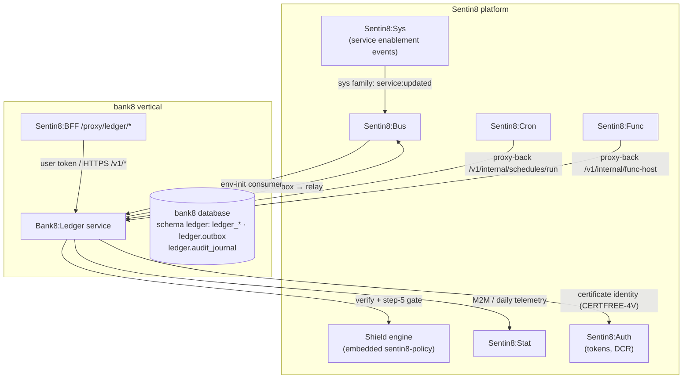

# Bank8:Ledger - README

The core-ledger service: accounts, products, postings, balances,
schedules, and the full configuration library (parameters, flags,
restrictions, calendars, plans, contracts) that drive them - the
system of record for money positions inside the bank8 vertical.

## Summary

Bank8:Ledger is a Rust service that owns the ledger's PostgreSQL schema
in the bank8 vertical database. It exposes the account/posting REST API
(through the platform's 8-step authorization pipeline), executes
double-entry posting batches with module validation, runs the scheduled
job engine, and publishes domain events through the local-outbox →
Sentin8:Bus producer path. Scheduling is delegated to Sentin8:Cron and
tenant-authored hooks to Sentin8:Func.

## Motivation

A core ledger must guarantee that money movement is atomic
(balance + transaction + posting rows commit together or not at all),
double-entry balanced, and auditable. It also carries a large
configuration surface - products compose validation modules whose
parameters resolve through a hierarchy (global → product → account), and
schedules/calendars drive time-based postings. The service centralizes
those invariants behind one policy-gated API instead of scattering them
across app code.

## Architecture & High-Level Design

## Key Traits and Data Structures

- `AppState` - config + capped pool + the shell-booted Shield engine +
  the cert-presenting Bus client; every handler extracts it from axum.
- `handlers::emit_event` - the DBX producer path helper (local outbox,
  pool flavor); posting paths use the in-transaction insert with `?`
  propagation.
- `modules` - the product validation module library (creation +
  posting-time validators, tiered rates, fee/dormancy schedules) as
  pure functions over `ModuleContext`.
- `schedules` - the scheduled-posting engine: due schedules generate
  posting batches in one transaction per batch.
- `set_tenant_context[_ext]` - the RLS stamping helpers; context is
  transaction-local and shares the connection with every dependent
  query.

## Rationale, Trade-offs, and Alternatives

- **Double-entry batch validation before any write**
  (`check_double_entry`) - a batch that doesn't net out per denomination
  is rejected 422 before a row is written; cheaper than compensating
  postings after the fact.
- **Module validation as pure functions** - the product rule set
  (limits, overdraft, sweeps) is unit-testable without a DB; the handler
  only wires the loaded product parameters.
- **Fail-closed event emission on postings** - audit + outbox inserts
  propagate errors inside the posting transaction: a posting whose
  audit/event write fails never commits (§8.4 of the technical design).
- **Cron/Func delegated, not embedded** - schedule timing and
  tenant-authored hooks are platform services; the ledger only implements
  the proxy-back handlers, so there is no second scheduler or a WASM
  runtime in the service.

## Internal Implementation & Invariants

- Postings are idempotent per `(env_id, idempotency_key)` (partial
  unique index + ON CONFLICT).
- Terminal states never regress (guarded updates everywhere).
- Every tenant table is FORCE-RLS'd on `env_id`; customer-held tables
  add holder-scoping (`sentin8:holder:view-all` is M2M-only).
- Money is `rust_decimal` end-to-end; JSON wire format is a string.

## Unresolved Questions / Future Designs

- ~~Statement generation~~ - **implemented** (DESIGN.md §10): scheduled
  generation writes documents to Sentin8:Storage (the `ledger-storage`
  M2M workload), and regeneration is a per-account-period Flow workflow
  with a proxy-back step.
- ~~Parameter-hierarchy caching~~ - **implemented** (DESIGN.md §10):
  bounded TTL cache on the `viewEffective` read API; the posting money
  path stays transactional by design.

---

**Architecture & Design:** bank8:ledger and its underlying concepts were designed by [Hamid Jahanzad](https://www.linkedin.com/in/hamidjahanzad/).
